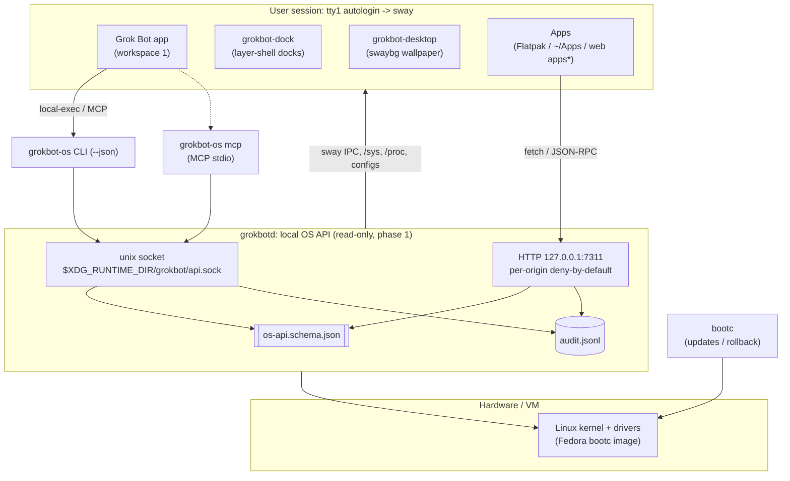

<div align="center">

```text
                         .-------------------.
                         |  .-----. .-----.  |        ( SI Inside )
                      []-|  | (o) | | (o) |  |-[]      /
                         |  '-----' '-----'  |   ____/
                         |     .-------.     |
                         |     \_______/     |
                         '---------+---------'
                         .---------+---------.
                        /  [#]  grok@os:~$ _  \
                       '-----------------------'
          ____ ____   ___  _  __  ____   ___ _____    ___  ____
         / ___|  _ \ / _ \| |/ / | __ ) / _ \_   _|  / _ \/ ___|
        | |  _| |_) | | | | ' /  |  _ \| | | || |   | | | \___ \
        | |_| |  _ <| |_| | . \  | |_) | |_| || |   | |_| |___) |
         \____|_| \_\\___/|_|\_\ |____/ \___/ |_|    \___/|____/

      > boot ........ [ OK ]   > grok-bot ..... [ ONLINE ]
      > os-api ...... [ OK ]   > hardware ..... [ UNDER CONTROL ]
```

**Grok Bot이 직접 하드웨어를 다루는, SI(Super Intelligence)를 위한 운영체제**<br>
**An operating system for SI, with Grok Bot built in and in control of the hardware**

</div>

> **Disclaimer.** Grok Bot OS is an independent, community-driven open-source project. It is **not** an official product of SpaceXSI and is not endorsed by or affiliated with SpaceXSI. "Grok Bot" is used to describe the app this OS is built around. Its trademarks belong to their owners.
>
> **고지.** Grok Bot OS는 독립적인 커뮤니티 오픈소스 프로젝트다. SpaceXSI의 공식 제품이 **아니며**, SpaceXSI가 보증하거나 관여하지 않는다. "Grok Bot"이라는 이름은 이 OS가 중심에 두는 앱을 가리키기 위해 쓴다. 상표권은 각 소유자에게 있다.

## 목적 / Mission

**한국어.** Grok Bot OS는 **head77x**가 시작한 오픈소스 프로젝트다. SpaceXSI의 Grok Bot 제품에서 영감을 받았다. 목표는 **SI(Super Intelligence)를 위한 완전한 운영체제**를 만드는 것이다. 그 OS 안에는 Grok Bot이 내장되고, Grok Bot이 모든 하드웨어 기능을 직접 제어한다. 이 아이디어는 일론 머스크가 언급한 패러다임을 실제로 구현해 보려는 데서 출발했다.

**English.** Grok Bot OS is an open-source project started by **head77x**, inspired by SpaceXSI's Grok Bot product. The goal is to build **a complete operating system for SI (Super Intelligence)**: an OS with Grok Bot embedded, where Grok Bot directly controls every hardware function. The idea began as an attempt to realize the paradigm Elon Musk has mentioned.

## 특징 / Features

- **Grok Bot 우선 / Grok Bot first.** 부팅하면 바로 Grok Bot이 뜬다. Grok Bot 0.71.2 Linux 앱이 amd64와 arm64 모두에 들어 있다. / Boots straight into the bundled Grok Bot Linux app (0.71.2, amd64 and arm64).
- **원자적 업데이트 / Atomic updates.** Fedora bootc 이미지라 업데이트와 롤백이 이미지 단위로 이뤄진다. / A Fedora bootc image: image-based updates and rollback.
- **로컬 OS API / Local OS API.** `grokbotd`가 OS 상태를 단일 JSON Schema로 노출한다. unix 소켓, `127.0.0.1:7311` HTTP, `grokbot-os` CLI, MCP stdio 서버로 접근한다. 웹 origin은 기본 거부이고 모든 호출은 감사 로그에 남는다. / `grokbotd` exposes the OS through one JSON Schema over a unix socket, HTTP on `127.0.0.1:7311`, the `grokbot-os` CLI and an MCP stdio server. Web origins are denied by default and every call is audited.
- **깔끔한 바탕화면 / Clean desktop.** 바탕화면 아이콘이 없다. 상·하·좌·우 독, `Alt+Tab`, 앱마다 자기 작업 공간, CC0 배경화면. / No desktop icons. Docks on any edge, `Alt+Tab`, one workspace per app, CC0 wallpaper.
- **앱 / Apps.** Flathub(`grokbot-install flatpak`)나 Grok Bot이 만든 로컬 앱(`grokbot-install local`)을 설치한다. 웹앱 런타임은 다음 단계다. / Install from Flathub or local apps built by Grok Bot. A web-app runtime is next.
- **계정을 저장하지 않음 / No accounts stored by the OS.** 로그인과 구독은 Grok Bot 앱이 한다. / Sign-in and subscription happen in the Grok Bot app.

## 아키텍처 / Architecture



<sub>* 웹앱 런타임은 2단계 / web-app runtime is phase 2.</sub>

### 부팅 순서 / Boot flow

```text
getty tty1 자동 로그인 (사용자 grokbot, 비밀번호 없음)
  -> sway  (바탕화면 아이콘 없음, 창 테두리 없음)
    -> grokbot-desktop (배경화면 swaybg, 아이콘 없음. docs/DESKTOP.md)
    -> grokbot-dock   (가장자리 독, 기본: 아래 독 아이콘만. docs/DOCK.md)
    -> grokbot-kiosk  (앱이 끝나면 1초 뒤 다시 실행)
      -> grokbot-launch
           native (기본):  /usr/bin/grok-bot  (Wayland 래퍼)
           placeholder: Firefox --kiosk --no-remote (전용 프로필)
```

키:

| 키 | 동작 |
|---|---|
| `Super+Space`, `Alt+Space` | 설치한 앱 목록 (fuzzel) |
| `Super+G`, `Alt+G` | Grok Bot 창으로 포커스 |
| `Alt+Tab`, `Alt+Shift+Tab` | 모든 작업 공간의 창 전환 |
| `Alt+F4`, `Super+Q` | 보고 있는 창 닫기 |
| `Ctrl+Alt+F2` | 설치할 때 만든 관리자 콘솔 |

창은 전체화면이 아니라 독을 뺀 영역에 최대화된다. Grok Bot은 작업 공간 1, 다른 앱은 각자 새 작업 공간에 열린다. 독 위치·모드는 `grokbot-dock-config`로 바꾼다.

Alt 조합을 같이 둔 이유: UTM 같은 VM은 Super 키를 넘기지 않는 경우가 있었다.

세션 데이터는 `/var/home/grokbot`에 남는다. tmpfiles가 매 부팅에 이 디렉터리를 만들되, 들어 있는 파일은 지우지 않는다. 네이티브 앱의 로그아웃은 앱 안에서 한다. `grokbot-sign-out`은 플레이스홀더 Firefox 프로필만 지운다. `http`/`https`는 그 프로필과 다른 Firefox 창으로 열고, `grokbot://`와 `sand://`는 Grok Bot으로 연다. `Alt+G`는 `app_id`가 `grok-bot`인 창으로 돌아온다.

## OS API (phase 1)

`grokbotd`는 읽기 전용 OS API를 제공한다. 메서드는 `system.info`, `windows.list`, `workspaces.list`, `dock.get`, `wallpaper.get`, `apps.list`, `power.status`, `network.status`이고, 정의는 [`os-api.schema.json`](system_files/usr/share/grokbot/api/os-api.schema.json) 하나에 있다. 자세한 내용은 [`docs/OS_API.md`](docs/OS_API.md)에 있다.

`grokbotd` serves a read-only OS API. The methods are listed above and are all defined in one schema file. Full reference: [`docs/OS_API.md`](docs/OS_API.md).

```bash
grokbot-os windows list                 # sway 창 목록 / windows from sway
grokbot-os --json system.info           # 기계가 읽는 출력 / machine-readable
grokbot-os audit -n 10                  # 감사 로그 / audit log
curl -s 127.0.0.1:7311/v1/health
```

| 전송 / Transport | 접근 / Access |
|---|---|
| unix 소켓 (0600, `SO_PEERCRED`) | 같은 사용자만 / same user only |
| HTTP `127.0.0.1:7311` | Host 검사, origin별 기본 거부(`~/.config/grokbot/api-permissions.json`) / Host check, per-origin deny by default |
| `grokbot-os mcp` | MCP stdio, 모든 도구가 `readOnlyHint` / all tools read-only |

## 설치와 테스트 / Install & try it

- **설치된 머신을 이 이미지로 바꾸기 / Switch an installed machine:** `sudo bootc switch ghcr.io/head77x/oais:latest` (amd64) 또는 `ghcr.io/head77x/oais-arm64:latest` (arm64)
- **VM에서 써 보기 / Try it in a VM:** [`docs/LOCAL_SETUP.md`](docs/LOCAL_SETUP.md)
- **테스트 / Tests:** `bash tests/run-tests.sh` (셸 테스트, grokbotd 단위 테스트, shellcheck. CI의 `check.yml`도 같은 테스트를 돌린다)

## 로컬 빌드 / Build locally

Podman과 just가 있는 Linux 머신에서. VM으로 띄우는 순서는 [`docs/LOCAL_SETUP.md`](docs/LOCAL_SETUP.md).

```bash
just build
```

아키텍처를 직접 지정할 때 (CI는 매트릭스 값을 넘긴다):

```bash
GROKBOT_TARGET_ARCH=amd64 just build   # 또는 arm64
```

플레이스홀더만 넣을 때:

```bash
GROKBOT_DISABLE_BUNDLED_APP=1 just build
```

다른 바이너리를 넣을 때는 체크섬이 필수다. 없으면 빌드는 실패한다.

```bash
GROKBOT_APP_SOURCE='https://example.invalid/GrokBot.AppImage' \
GROKBOT_APP_SHA256='64자리hex' \
just build
```

## 현재 상태 / Status

**2026-10-20 로컬 VM에서 확인** (x86_64, QEMU, KVM 없이 TCG 에뮬레이션, UEFI. 디스크는 `bootc install to-filesystem`으로 수동 생성):

- [x] `podman build`로 이미지 빌드, Grok Bot 0.71.2 RPM 설치 (#12에서 빌드 오류 2건 수정)
- [x] 부팅 → tty1 자동 로그인 → sway → 전체화면 Grok Bot 로그인 화면 (`app_id` `grok-bot`, Wayland)
- [x] `Alt+Space` → "앱 실행" 런처(fuzzel)가 Grok Bot 위에 표시, Firefox는 목록에서 숨김
- [x] 런처에서 앱(Foot) 실행, `Alt+G`로 전체화면 Grok Bot 복귀
- [x] `bootc status`, `grokbot-factory-reset --dry-run`

**아직 확인하지 않은 것:**

- [ ] SELinux enforcing (VM 디스크는 라벨 없이 설치되어 `selinux=0`으로 부팅)
- [ ] bootc-image-builder로 만든 ISO / qcow2 설치
- [ ] KVM 속도에서의 동작, 실제 하드웨어 ([`docs/HARDWARE.md`](docs/HARDWARE.md))
- [ ] Grok Bot 계정 로그인 이후 화면

2026-07-09에는 **이전 이미지**를 Apple Silicon UTM(arm64)에 ISO로 설치하고 `bootc status`까지 확인했다. 지금 이미지의 arm64 부팅은 확인하지 않았다.

## 로드맵 / Roadmap

- [x] **0단계 / Phase 0**: bootc 이미지, Grok Bot 키오스크, 런처, 독, 배경화면, 공장 초기화 초안
- [x] **1단계 / Phase 1**: 읽기 전용 OS API. `grokbotd`, `grokbot-os` CLI, MCP stdio, origin별 기본 거부, 감사 로그
- [ ] **2단계 / Phase 2**: 웹앱 런타임과 설치. Chromium `--app` 모드, 서명된 `.gbapp` 번들, `grokbot-install web`, **오프라인 실행과 로컬 저장소**. Firefox를 빼고 Chromium으로 일원화한다.
- [ ] **이후 / Later**:
  - 쓰기 API와 사용자 동의 창(실행할 때마다 토큰, polkit) / write API with a consent prompt, per-launch tokens and polkit
  - 바탕화면 위젯 / desktop widgets
  - 하드웨어 드라이버 흐름(bootc) / hardware driver flow on bootc ([`docs/HARDWARE.md`](docs/HARDWARE.md))
  - Grok Bot이 만든 앱의 빌드 파이프라인 / a build pipeline for apps Grok Bot generates

세부 계획: [`docs/ROADMAP.md`](docs/ROADMAP.md)

## 문서 / Docs

| 문서 | 내용 |
|---|---|
| [`docs/LOCAL_SETUP.md`](docs/LOCAL_SETUP.md) | 로컬 VM 테스트 / local VM testing |
| [`docs/OS_API.md`](docs/OS_API.md) | OS API, 보안 모델, CLI, MCP |
| [`docs/DOCK.md`](docs/DOCK.md) | 독과 창 배치 / docks & window layout |
| [`docs/DESKTOP.md`](docs/DESKTOP.md) | 배경화면, 바탕화면 층 / wallpaper & desktop layer |
| [`docs/GROKBOT_APP.md`](docs/GROKBOT_APP.md) | 앱을 이미지에 넣는 방법 / bundling the app |
| [`docs/GROKBOT_INSTALL.md`](docs/GROKBOT_INSTALL.md) | `grokbot-install` 규격 / spec |
| [`docs/HARDWARE.md`](docs/HARDWARE.md) | 하드웨어와 드라이버 / hardware & drivers |
| [`docs/ROADMAP.md`](docs/ROADMAP.md) | 로드맵 / roadmap |
| [`docs/DECISIONS.md`](docs/DECISIONS.md) | 결정 기록 / decision log |

## 공장 초기화 / Factory reset

```bash
sudo grokbot-factory-reset --dry-run        # 지울 목록만 출력
sudo grokbot-factory-reset --confirm RESET  # /var/home/grokbot 안의 내용만 지움
```

`--confirm RESET` 없이는 아무것도 지우지 않고, `--dry-run`이 있으면 항상 지우지 않는다. `/usr`와 bootc 배포는 건드리지 않는다. 전체 `/var` 초기화와 첫 부팅 재실행은 아직 없다([`docs/DECISIONS.md`](docs/DECISIONS.md)).

## 디렉터리 / Repository layout

```text
Containerfile                         fedora-bootc 이미지
Justfile                              just build, 디스크 이미지
oais.env                              IMAGE_NAME=oais (유지)
build_files/build.sh                  패키지, os-release, grokbot 계정
build_files/install-grokbot-app.sh    페이로드 또는 플레이스홀더
grokbot-app/                          로컬 페이로드 자리. 기본은 비어 있음
system_files/etc/grokbot/app.conf     grokbot-launch 가 읽는 설정
system_files/etc/sway/config          키오스크
system_files/usr/local/bin/grokbot-*  세션, 실행, 설치, 로그아웃, 공장 초기화 초안, grokbot-os CLI
system_files/usr/lib/grokbot/grokbotd 로컬 OS API 데몬 (docs/OS_API.md)
system_files/usr/share/grokbot/api/   OS API JSON Schema (단일 원천)
disk_config/                          ISO / qcow2
.github/workflows/build.yml           GHCR oais, oais-arm64
.github/workflows/build-disk.yml      qcow2 / anaconda ISO
.github/workflows/check.yml           셸 테스트. 이미지는 안 만듦
docs/                                 문서 (OS_API.md, DOCK.md, DESKTOP.md ...)
tests/
legacy/orchestrator/                  예전 OAIS(AI-OS) 오케스트레이터 코드. 이미지에 없음, 참고용
```

## 이름을 바꾸지 않은 것 / Names kept on purpose

| 그대로 | 이유 |
|---|---|
| GitHub 저장소 `head77x/oais` | 저장소 이름 |
| `ghcr.io/head77x/oais`, `ghcr.io/head77x/oais-arm64` | 기존 pull, 서명, 디스크 빌드 |
| `oais.env`의 `IMAGE_NAME=oais` | 워크플로가 이 값으로 이미지 이름을 만든다 |
| `disk_config/iso.toml`의 `ghcr.io/head77x/oais:latest` | `build-disk.yml`이 이 문자열을 바꿔 넣는다 |
| S3 접두사 `oais/`, 아티팩트 `oais-<타입>-<아키텍처>` | 받아 가던 경로 |
| `/etc/os-release`의 `ID=fedora` | bootc와 패키지 도구가 ID를 본다 |

`NAME` / `PRETTY_NAME` / `VARIANT`는 Grok Bot OS다.

## 라이선스와 출처 / License & credits

- 이 저장소의 코드와 문서는 [Apache License 2.0](LICENSE)을 따른다. 템플릿 골격은 [ublue-os/image-template](https://github.com/ublue-os/image-template)(Apache-2.0)에서 왔다. / Code and docs: Apache-2.0. The template skeleton comes from ublue-os/image-template.
- 배경화면 `lofoten.jpg`: Johannes Groll(Unsplash: followhansi), "Aurora over Flakstad, Lofoten, Norway", **CC0 1.0**. 자세한 내용은 [`CREDITS.md`](system_files/usr/share/grokbot/wallpapers/CREDITS.md)에 있다.
- Grok Bot Linux 앱은 이 저장소의 라이선스에 포함되지 않는다. 앱 자체의 라이선스를 따르며, 빌드할 때 공식 배포 URL에서 받는다(체크섬 확인). / The Grok Bot app is not covered by this repository's license. It is downloaded at build time from its official distribution URL, checksum-verified.
